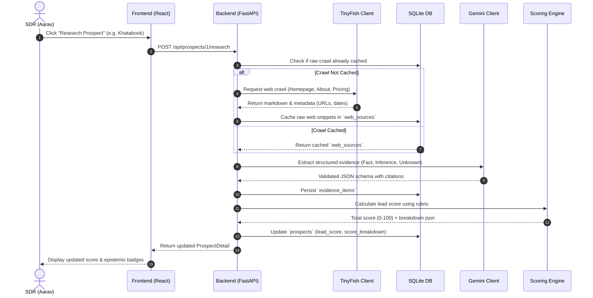

# System Architecture Document
## Project: LeadForge — Evidence-First Sales Intelligence
**Document Version:** 1.0.0  
**Target Stack:** React (Vite) + Tailwind CSS | Python 3.12 (FastAPI) | SQLite | TinyFish | Gemini

---

## 1. System Overview

LeadForge is designed around a decoupled, local-first client-server architecture. The backend (FastAPI) manages external API integrations (TinyFish web scraping and Gemini LLM analysis), enforces security boundaries, controls local database persistence (SQLite), and serves clean REST endpoints to the frontend.

The frontend (React + Vite + Tailwind CSS) provides an intuitive, high-density dashboard for configuring ICPs, monitoring research progress, inspecting granular evidence citations with epistemic badges, and reviewing/exporting outreach drafts.

### High-Level Component Diagram

```mermaid
graph TD
    subgraph Client [Frontend - React / Vite / Tailwind]
        UI[Dashboard & Review UI]
        State[React State & Query Client]
        Export[CSV Exporter]
    end

    subgraph Server [Backend - Python 3.12 / FastAPI]
        Router[API Router / Endpoints]
        Orchestrator[Research Orchestrator]
        ScoringEngine[100-Point Rubric Engine]
        DBClient[Database Access Layer - SQLite]
    end

    subgraph External [External Services & APIs]
        TinyFishAPI[TinyFish Web Scraping API]
        GeminiAPI[Gemini LLM API]
    end

    subgraph Storage [Local Storage]
        SQLite[(leadforge.db - SQLite WAL)]
    end

    UI <-->|HTTP / REST (JSON)| Router
    Router --> Orchestrator
    Orchestrator -->|HTTP Request| TinyFishAPI
    Orchestrator -->|HTTP Request| GeminiAPI
    Orchestrator --> ScoringEngine
    Orchestrator --> DBClient
    DBClient <--> SQLite
    Export -.->|Direct CSV Download| UI
```

---

## 2. Technology Stack & Key Decisions

| Layer | Technology | Decision Rationale |
|---|---|---|
| **Frontend Framework** | React 18+ (Vite) | Fast developer feedback, minimal build footprint, component modularity. |
| **Styling** | Tailwind CSS | Rapid utility-first styling, consistent design token usage, clean badge aesthetics. |
| **Backend Framework** | Python 3.12 + FastAPI | Native asynchronous execution, automatic OpenAPI schema generation, typed data validation via Pydantic v2. |
| **Database** | SQLite (Local) / Neon PostgreSQL (Production) | Dual database support: SQLite WAL locally for zero-latency offline development; Neon Serverless PostgreSQL in production (₹0/mo, 1GB storage, PgBouncer pooling). |
| **ORM / Data Access** | SQLAlchemy 2.0 (Async) / aiosqlite / asyncpg | Robust schema declaration, parameterized queries, dialect-aware initialization (SQLite PRAGMAs vs Postgres pooling). |
| **Web Scraping** | TinyFish API | Handles dynamic rendering, bot mitigation, and extracts clean markdown/text. Free tier provides recurring 1,000 URLs/day via TinyFetch. |
| **LLM & Analysis** | Gemini API (`gemini-2.5-flash` / `gemini-3.8-flash`) | Fast, cost-efficient, 1M+ context window, native support for JSON schema-constrained output. Generous free tier via Google AI Studio. |
| **Version Control** | Git | Standard version control, strict `.gitignore` to prevent secret leakage. |

---

## 3. Directory Structure

The repository follows a clean monorepo structure separating client, server, and shared assets:

```
LeadForge/
├── .gitignore
├── README.md
├── PRD.md
├── ARCHITECTURE.md
├── DATABASE.md
├── DESIGN_SYSTEM.md
├── SECURITY.md
├── CODE_STYLE.md
├── TESTING.md
├── AGENTS.md
│
├── backend/
│   ├── pyproject.toml
│   ├── requirements.txt
│   ├── .env.example
│   ├── app/
│   │   ├── __init__.py
│   │   ├── main.py                   # FastAPI app entry point, CORS, lifecycle
│   │   ├── config.py                 # Pydantic BaseSettings, API keys
│   │   ├── api/
│   │   │   ├── __init__.py
│   │   │   ├── routes_icp.py         # ICP management endpoints
│   │   │   ├── routes_prospects.py   # Prospect CRUD, research trigger
│   │   │   ├── routes_search.py      # Tavily general-purpose web search
│   │   │   ├── routes_outreach.py    # Email draft generation
│   │   │   └── routes_export.py      # CSV export generation
│   │   ├── db/
│   │   │   ├── __init__.py
│   │   │   ├── session.py            # SQLite connection engine & session
│   │   │   ├── models.py             # SQLAlchemy model definitions
│   │   │   └── seed_data.py          # 10 initial Indian SMB SaaS domains
│   │   ├── schemas/
│   │   │   ├── __init__.py
│   │   │   ├── icp_schema.py         # Pydantic models for ICP
│   │   │   ├── prospect_schema.py    # Pydantic models for prospects & evidence
│   │   │   ├── search_schema.py      # Pydantic models for web search
│   │   │   └── outreach_schema.py    # Pydantic models for drafts
│   │   ├── services/
│   │   │   ├── __init__.py
│   │   │   ├── tavily_client.py      # Tavily Search API wrapper + mock fallback
│   │   │   ├── tinyfish_client.py    # TinyFish API wrapper + mock fallback
│   │   │   ├── gemini_client.py      # Gemini API wrapper + schema enforcement
│   │   │   ├── evidence_extractor.py # Fact / Inference / Unknown extraction
│   │   │   └── scoring_engine.py     # 100-point rubric calculation
│   │   └── tests/
│   │       ├── conftest.py
│   │       ├── test_custom_prospects.py
│   │       ├── test_tavily_search.py
│   │       ├── test_scoring.py
│   │       ├── test_evidence.py
│   │       └── test_api_routes.py
│   └── data/
│       └── leadforge.db              # Local SQLite database (git-ignored)
│
└── frontend/
    ├── package.json
    ├── vite.config.js
    ├── tailwind.config.js
    ├── postcss.config.js
    ├── index.html
    └── src/
        ├── main.jsx
        ├── App.jsx
        ├── index.css
        ├── api/
        │   └── client.js             # Fetch wrapper communicating with FastAPI
        ├── components/
        │   ├── Header.jsx            # Top navigation bar
        │   ├── WebSearchModal.jsx    # General-purpose web search modal
        │   ├── AddProspectModal.jsx  # Custom company addition modal
        │   ├── IcpConfigModal.jsx    # ICP settings modal
        │   ├── ProspectList.jsx      # Prospect data table / cards
        │   ├── ProspectRow.jsx       # Individual prospect row
        │   ├── ScoreBadge.jsx        # Explainable score pill
        │   ├── EpistemicBadge.jsx    # FACT / INFERENCE / UNKNOWN pill
        │   ├── EvidenceModal.jsx     # Granular evidence inspection drawer
        │   ├── OutreachModal.jsx     # Grounded email preview & copy
        │   └── ExportButton.jsx      # CSV export trigger
        ├── hooks/
        │   └── useProspects.js       # Data fetching & local state hook
        └── utils/
            └── formatters.js         # Date and score formatting helpers
```

---

## 4. API Specification & Boundaries

All frontend requests target the `/api` prefix on the backend. No external calls (TinyFish, Gemini) originate from the client.

### Endpoints Matrix

| Method | Endpoint | Description | Request Body | Response Body |
|---|---|---|---|---|
| `GET` | `/api/health` | Service health status | None | `{"status": "ok", "db": true}` |
| `GET` | `/api/icp` | Retrieve active ICP | None | `IcpResponse` |
| `POST` | `/api/icp` | Update active ICP | `IcpUpdateSchema` | `IcpResponse` |
| `GET` | `/api/prospects` | List all researched prospects | None (query params: `min_score`, `search`) | `List[ProspectSummarySchema]` |
| `POST` | `/api/prospects` | Create a new custom prospect company | `ProspectCreateSchema` | `ProspectSummarySchema` |
| `POST` | `/api/prospects/seed` | Seed the 10 target Indian SaaS companies | None | `List[ProspectSummarySchema]` |
| `POST` | `/api/prospects/{id}/research` | Trigger web crawl & extraction | None | `ProspectDetailSchema` |
| `GET` | `/api/prospects/{id}` | Full prospect detail with evidence | None | `ProspectDetailSchema` |
| `POST` | `/api/prospects/{id}/draft` | Generate evidence-grounded outreach | `DraftOptionsSchema` | `OutreachDraftSchema` |
| `POST` | `/api/search` | General-purpose web search via Tavily | `SearchRequest` | `SearchResponse` |
| `GET` | `/api/search` | Lightweight web search query | Query param: `q` | `SearchResponse` |
| `GET` | `/api/export/csv` | Export all qualified prospects to CSV | None | CSV file attachment |

---

## 5. End-to-End Execution Sequence

### Research and Evidence Extraction Flow



---

## 6. External Integration Boundaries & Fallback Strategy

### 6.1 TinyFish API Client Adapter
* **Role:** Fetches clean page text and metadata without frontend overhead.
* **Unverified Boundary Defense:** Because external TinyFish API endpoint formats, rate limits, and schemas are unverified, the integration is fully encapsulated behind an abstract client adapter (`TinyFishClientBase`).
* **Timeout & Retries:** Maximum 30s timeout per page; max 2 retries with exponential backoff on HTTP 429/503.
* **Mock Provider Mode (Default):** When `USE_MOCK_APIS=true` (or when no API key is supplied), the backend serves deterministic, realistic crawl snippets for the 10 target Indian SaaS prospects. This guarantees a working development cycle without third-party dependencies.

### 6.2 Gemini API Client Adapter
* **Role:** Analyzes crawled text, extracts epistemic assertions, verifies citations, and composes cold outreach.
* **Model Configuration:** Configured via the `GEMINI_MODEL` environment variable (defaults to `gemini-2.5-flash`, with support for `gemini-3.8-flash`, `gemini-3.5-flash-lite`, `gemini-2.5-pro`, and legacy models). Operates with `temperature=0.1` (low temperature enforces deterministic adherence to facts).
* **Schema Enforcement:** Strict Pydantic model passed as `response_schema` to guarantee valid JSON formatting.
* **Mock Provider Mode:** Includes pre-computed structured responses for the 10 target prospects when offline or if quota is exhausted.

---

## 7. Caching & Efficiency Strategy

1. **Raw Crawl Persistence:** Crawled HTML and extracted text snippets are stored in the `web_sources` table. Repeated analysis or prompt adjustments do not trigger new web requests.
2. **Deterministic Hashing:** A SHA-256 hash of the scraped text is recorded to detect whether external content has changed prior to re-running LLM extraction.
3. **Chunking & Token Budgeting:** Large scraped pages are pruned of navigation links, footers, and scripts, keeping payload sizes below 8,000 tokens per prospect extraction call to conserve LLM quota.

---

## 8. Deployment & Zero-Cost Architecture (₹0 Recurring Cost)

### 8.1 Zero-Cost Production Topology
* **Frontend: Cloudflare Pages (₹0/mo)**
  * Global Anycast CDN, unlimited bandwidth, 500 builds/month, zero cold starts, custom domain with automatic SSL.
  * Environment variable `VITE_API_URL` points to backend on Render.
* **Backend: Render Free Web Service (₹0/mo)**
  * Python 3.12 Docker service (`leadforge-backend`).
  * 750 free instance hours/month (covers 1 continuous web service 24/7 without exceeding quota).
  * Automatically spins down to 0 after 15 minutes of inactivity; wakes up on incoming HTTP traffic (~45-60s cold start).
  * No credit card required.
* **Database: Neon Serverless PostgreSQL (₹0/mo)**
  * 1 GB persistent storage, 100 Compute Unit (CU) hours/month, unthrottled PgBouncer connection pooling.
  * Solves ephemeral filesystem limitations without paid Render persistent disks ($7/month).
  * Auto-suspends after 5 minutes of inactivity (0 compute usage while idle); wakes in ~500ms on first query.
  * No credit card required; data is never deleted due to inactivity.

### 8.2 Local & Container Development Topology
* **Local Database:** SQLite with Write-Ahead Logging (`leadforge.db`), initialized via `aiosqlite`.
* **Docker Compose:** `docker-compose.yml` mounts named volume `leadforge_sqlite_data` to `/app/backend/data`, preserving data across container restarts.

### 8.3 3-Tier Health Check & Status Model
The `/api/health` endpoint dynamically inspects database connectivity and live API credentials, returning:
1. `MOCK`: Running offline or `USE_MOCK_APIS=true` without external API credentials.
2. `LIVE_CONFIGURED`: API keys detected in environment, but live connectivity not yet validated against external provider endpoints.
3. `LIVE_VERIFIED`: Real HTTP handshake (`GET https://generativelanguage.googleapis.com/v1beta/models/{model}`) successfully completed with < 5s latency.
