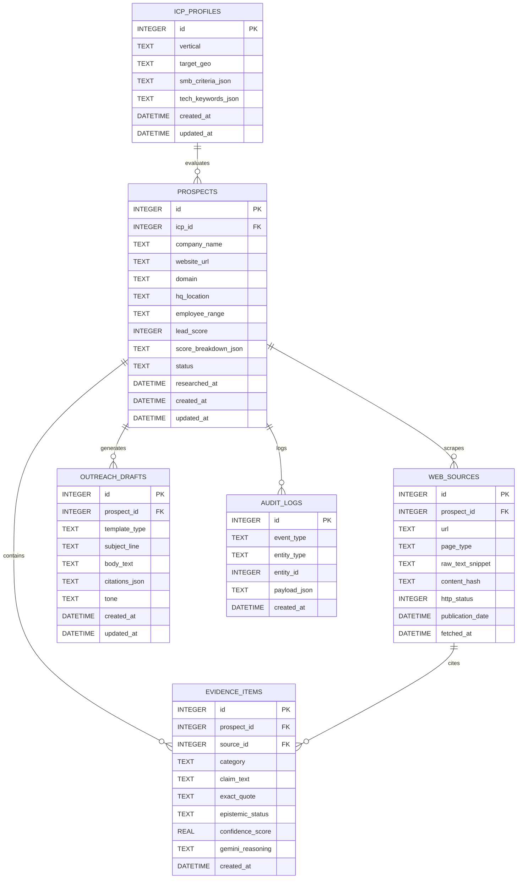

# Database Architecture & Schema Specification
## Project: LeadForge — Evidence-First Sales Intelligence
**Document Version:** 1.1.0<br/>
**Database Engines:** Dual Database Support:
- **Local Development & Testing:** SQLite 3 (WAL Mode, Foreign Keys Enforced) via `aiosqlite`
- **Production Deployment (₹0 Zero-Cost):** Neon Serverless PostgreSQL (Auto-suspended, connection pooling) via `asyncpg`
**ORM / Driver:** SQLAlchemy 2.0 (Async) + `aiosqlite` / `asyncpg`

---

## 1. Database Configuration & Dual Dialect Support

LeadForge supports dual database dialects seamlessly without code branching:

### Local Development (SQLite):
SQLite is used locally for zero-latency local execution, portability, and zero-cost offline development. Connection pragmas are attached via SQLAlchemy connect listeners only when running on SQLite:

```sql
PRAGMA journal_mode = WAL;          -- Write-Ahead Logging for concurrent readers/writers
PRAGMA synchronous = NORMAL;         -- Balances write speed with durability
PRAGMA foreign_keys = ON;            -- Enforces relational integrity
PRAGMA busy_timeout = 5000;          -- 5-second wait on lock contention
PRAGMA cache_size = -64000;          -- 64MB memory page cache
```

### Production Deployment (Neon Serverless PostgreSQL):
In production on Render Free Web Service, LeadForge connects to a free Neon Serverless PostgreSQL instance (`postgresql+asyncpg://...`):
- **Serverless Scaling:** Neon scales down to zero compute after 5 minutes of inactivity, consuming 0 CU hours while idle, and wakes within ~500ms.
- **Connection Pooling:** Connects through Neon's PgBouncer pooled endpoint (`ep-xyz-pooler.region.aws.neon.tech`) to maintain rock-solid connection handling within free limits (up to 10,000 pooled connections).
- **Persistent Data:** Guarantees full data persistence across Render container sleep and redeploy cycles without ephemeral filesystem loss.
- **Cross-Dialect DDL:** Timestamps compile via `func.now()`, rendering `CURRENT_TIMESTAMP` on SQLite and `now()` on PostgreSQL. Tables and indexes are cross-compatible across both dialects.

---

## 2. Entity Relationship (ER) Diagram



---

## 3. Detailed Table Definitions & DDL

### 3.1 `icp_profiles`
Stores the active Ideal Customer Profile criteria against which prospects are evaluated.

```sql
CREATE TABLE IF NOT EXISTS icp_profiles (
    id INTEGER PRIMARY KEY AUTOINCREMENT,
    vertical TEXT NOT NULL DEFAULT 'B2B SaaS serving SMBs / MSMEs',
    target_geo TEXT NOT NULL DEFAULT 'India',
    smb_criteria_json TEXT NOT NULL DEFAULT '["Self-serve onboarding", "Pricing in INR", "Mobile-first / WhatsApp capability", "Simplified SME workflows"]',
    tech_keywords_json TEXT NOT NULL DEFAULT '["SaaS", "cloud", "subscription", "API", "merchant", "invoicing", "kirana", "MSME"]',
    created_at DATETIME NOT NULL DEFAULT (DATETIME('now', 'utc')),
    updated_at DATETIME NOT NULL DEFAULT (DATETIME('now', 'utc'))
);
```

### 3.2 `prospects`
Represents the target SaaS companies being researched.

```sql
CREATE TABLE IF NOT EXISTS prospects (
    id INTEGER PRIMARY KEY AUTOINCREMENT,
    icp_id INTEGER NOT NULL DEFAULT 1,
    company_name TEXT NOT NULL,
    website_url TEXT NOT NULL,
    domain TEXT NOT NULL UNIQUE,
    hq_location TEXT NULL,
    employee_range TEXT NULL,
    lead_score INTEGER NOT NULL DEFAULT 0 CHECK (lead_score >= 0 AND lead_score <= 100),
    score_breakdown_json TEXT NULL,      -- JSON dictionary of rubric category contributions
    status TEXT NOT NULL DEFAULT 'PENDING' CHECK (status IN ('PENDING', 'RESEARCHING', 'ANALYZED', 'FAILED')),
    researched_at DATETIME NULL,
    created_at DATETIME NOT NULL DEFAULT (DATETIME('now', 'utc')),
    updated_at DATETIME NOT NULL DEFAULT (DATETIME('now', 'utc')),
    FOREIGN KEY (icp_id) REFERENCES icp_profiles (id) ON DELETE RESTRICT
);
```

> **Custom Ingestion Note:** Custom companies added via `POST /api/prospects` insert into this table with `status = 'PENDING'`, `lead_score = 0`, and the normalized root domain. The `UNIQUE` constraint on `domain` and application-level pre-checks ensure no duplicate domain entries can be created.

### 3.3 `web_sources`
Stores scraped web pages obtained via TinyFish to provide raw citations and support caching.

```sql
CREATE TABLE IF NOT EXISTS web_sources (
    id INTEGER PRIMARY KEY AUTOINCREMENT,
    prospect_id INTEGER NOT NULL,
    url TEXT NOT NULL,
    page_type TEXT NOT NULL DEFAULT 'HOMEPAGE' CHECK (page_type IN ('HOMEPAGE', 'ABOUT', 'PRICING', 'PRODUCT', 'BLOG', 'OTHER')),
    raw_text_snippet TEXT NOT NULL,
    content_hash TEXT NOT NULL,          -- SHA-256 hash to detect changes
    http_status INTEGER NOT NULL DEFAULT 200,
    publication_date DATETIME NULL,      -- Extracted from meta tags/HTML if available
    fetched_at DATETIME NOT NULL DEFAULT (DATETIME('now', 'utc')),
    FOREIGN KEY (prospect_id) REFERENCES prospects (id) ON DELETE CASCADE
);
```

### 3.4 `evidence_items`
Core epistemic evidence unit. Distinguishes verified facts, reasoned inferences, and identified unknowns.

```sql
CREATE TABLE IF NOT EXISTS evidence_items (
    id INTEGER PRIMARY KEY AUTOINCREMENT,
    prospect_id INTEGER NOT NULL,
    source_id INTEGER NULL,              -- Nullable for 'UNKNOWN' items
    category TEXT NOT NULL CHECK (category IN ('SMB_FOCUS', 'SAAS_MODEL', 'GROWTH_SIGNAL', 'TECH_FIT', 'COMPANY_PROFILE')),
    rubric_criterion TEXT NULL,          -- Direct mapping key for 100-pt rubric (e.g., 'MSME_EXPLICIT_FOCUS', 'INR_PRICING')
    claim_text TEXT NOT NULL,            -- Summarized assertion
    exact_quote TEXT NULL,               -- Direct verbatim excerpt from web_sources
    epistemic_status TEXT NOT NULL CHECK (epistemic_status IN ('FACT', 'INFERENCE', 'UNKNOWN')),
    confidence_score REAL NOT NULL DEFAULT 1.0 CHECK (confidence_score >= 0.0 AND confidence_score <= 1.0),
    gemini_reasoning TEXT NULL,          -- Explanation, mandatory when epistemic_status = 'INFERENCE'
    created_at DATETIME NOT NULL DEFAULT (DATETIME('now', 'utc')),
    FOREIGN KEY (prospect_id) REFERENCES prospects (id) ON DELETE CASCADE,
    FOREIGN KEY (source_id) REFERENCES web_sources (id) ON DELETE SET NULL
);
```

### 3.5 `outreach_drafts`
Stores AI-generated personalized email drafts with strict evidence citations.

```sql
CREATE TABLE IF NOT EXISTS outreach_drafts (
    id INTEGER PRIMARY KEY AUTOINCREMENT,
    prospect_id INTEGER NOT NULL,
    template_type TEXT NOT NULL DEFAULT 'EVIDENCE_PROBLEM_SOLUTION',
    subject_line TEXT NOT NULL,
    body_text TEXT NOT NULL,
    citations_json TEXT NOT NULL,        -- Array of referenced evidence_item IDs
    tone TEXT NOT NULL DEFAULT 'CONSULTATIVE_DIRECT',
    created_at DATETIME NOT NULL DEFAULT (DATETIME('now', 'utc')),
    updated_at DATETIME NOT NULL DEFAULT (DATETIME('now', 'utc')),
    FOREIGN KEY (prospect_id) REFERENCES prospects (id) ON DELETE CASCADE
);
```

### 3.6 `audit_logs` (Deferred for Hackathon MVP)
> [!NOTE]
> **Scope Optimization:** For the 3–5 day MVP, structured application logging via Python's standard `logging` module handles all audit events. The `audit_logs` table schema is preserved here as a design specification for post-MVP enterprise compliance.

```sql
-- Optional / Post-MVP:
CREATE TABLE IF NOT EXISTS audit_logs (
    id INTEGER PRIMARY KEY AUTOINCREMENT,
    event_type TEXT NOT NULL,            -- e.g., 'RESEARCH_STARTED', 'EVIDENCE_EXTRACTED', 'SCORE_CALCULATED'
    entity_type TEXT NOT NULL,           -- 'PROSPECT', 'EVIDENCE', 'OUTREACH'
    entity_id INTEGER NOT NULL,
    payload_json TEXT NULL,
    created_at DATETIME NOT NULL DEFAULT (DATETIME('now', 'utc'))
);
```

---

## 4. Performance Indexes

```sql
CREATE INDEX IF NOT EXISTS idx_prospects_domain ON prospects(domain);
CREATE INDEX IF NOT EXISTS idx_prospects_status ON prospects(status);
CREATE INDEX IF NOT EXISTS idx_prospects_score ON prospects(lead_score DESC);
CREATE INDEX IF NOT EXISTS idx_web_sources_prospect_id ON web_sources(prospect_id);
CREATE INDEX IF NOT EXISTS idx_web_sources_hash ON web_sources(content_hash);
CREATE INDEX IF NOT EXISTS idx_evidence_prospect_status ON evidence_items(prospect_id, epistemic_status);
CREATE INDEX IF NOT EXISTS idx_outreach_prospect ON outreach_drafts(prospect_id);
```

---

## 5. Seed Data Plan (10 Indian SMB SaaS Prospects)

The seed script will populate 10 prominent Indian B2B SaaS companies serving small and medium businesses to provide immediate MVP evaluation:

| # | Company Name | Domain | Known SMB Alignment Focus |
|---|---|---|---|
| 1 | Khatabook | `khatabook.com` | Digital ledger, merchant invoicing & credit tracking for Indian Kiranas. |
| 2 | myBillBook (FloBiz) | `mybillbook.in` | GST billing, inventory & accounting software for Indian SME traders. |
| 3 | Dukaan | `mydukaan.io` | E-commerce storefront builder for retail merchants and small brands. |
| 4 | Vyapar | `vyaparapp.in` | Business accounting, GST invoicing & billing app for Indian MSMEs. |
| 5 | Shiprocket | `shiprocket.in` | Automated shipping & logistics aggregation platform for SMB e-commerce. |
| 6 | Classplus | `classplus.co` | Mobile-first SaaS enabling coaching institutes and educators to run digital academies. |
| 7 | Restroworks (POSist) | `restroworks.com` | Cloud-based restaurant management & POS for single-location to multi-chain eateries. |
| 8 | Exotel | `exotel.com` | Cloud customer engagement, VoIP & SMS communication platform for growth SMBs. |
| 9 | Zoho | `zoho.com` | Broad cloud software suite (Books, CRM) tailored for cost-conscious SMBs. |
| 10 | Freshworks | `freshworks.com` | Modern, easy-to-implement customer service (Freshdesk) & CRM for mid-market/SMBs. |

---

## 6. Migration & Schema Initialization Strategy

To avoid heavyweight migration frameworks for this 3–5 day MVP, the backend will utilize:
1. An idempotent initialization script (`app/db/session.py:init_db()`) executing `CREATE TABLE IF NOT EXISTS` and index creation during FastAPI startup.
2. An automated seed verification routine (`app/db/seed_data.py`) ensuring the 10 target companies exist on initial launch.
